  

  
  

I build the data warehouse behind **T-Bank's** e-commerce and lifestyle services: grocery delivery, fuel, hotels and subscriptions. I design data models and marts, build batch and streaming pipelines, and prepare data for analytics, financial reporting, A/B testing and machine learning.

Alongside that, I'm doing a master's in Artificial Intelligence at **ITMO's AI Talent Hub** and taking ML to hackathons.

## Impact at T-Bank

<table>
  <tr>
    <td align="center" valign="top" width="25%"><h3>12×</h3>faster receipt-processing batches</td>
    <td align="center" valign="top" width="25%"><h3>~1 TB</h3>of storage freed by moving to append-only logs</td>
    <td align="center" valign="top" width="25%"><h3>15–30%</h3>faster queries from decimal column optimization</td>
    <td align="center" valign="top" width="25%"><h3>15 min</h3>streaming aggregates from three Kafka topics</td>
  </tr>
</table>

- **Intraday marts** for orders, GMV, revenue and cashback across grocery delivery, fuel and hotels
- **Financial reporting:** a hotel cashback forecast that switches to actual accruals once the accrual window closes, and partner-level breakdowns in seven revenue marts
- **Experimentation:** a unified metrics layer for A/B testing
- **Subscriptions:** reworked data versioning and customer identification, removing manual corrections from retention and churn analysis
- **Migrations:** sources moved from legacy replication to Kafka-based ingestion, and marts prepared for the move from Greenplum to a lakehouse
- **ML features:** fuel-service feature calculations moved from analysts' notebooks into four ETL pipelines feeding a feature store

## Hackathon awards

🏆 **DevWeek 2025, winning project: AI-Generated Text Detection System** 
An end-to-end ML service built on a dataset of about 2.5 million records: fine-tuned XLM-RoBERTa combined with an LLM-based ensemble, delivered as a web interface, an API and a Telegram bot.

🏅 **EESTech Challenge 2025, prize-winning project: Tractor Telemetry Analysis and Failure Prediction** 
A transformer-based solution that uses equipment telemetry to predict potential failures and assess machinery usage, with an interactive Streamlit app for exploring the results.

## Stack

**Data engineering**

**ML and AI**

## Education

- **MSc, Artificial Intelligence:** ITMO University, AI Talent Hub (in progress)
- **BSc, Applied Mathematics:** Peter the Great St. Petersburg Polytechnic University
